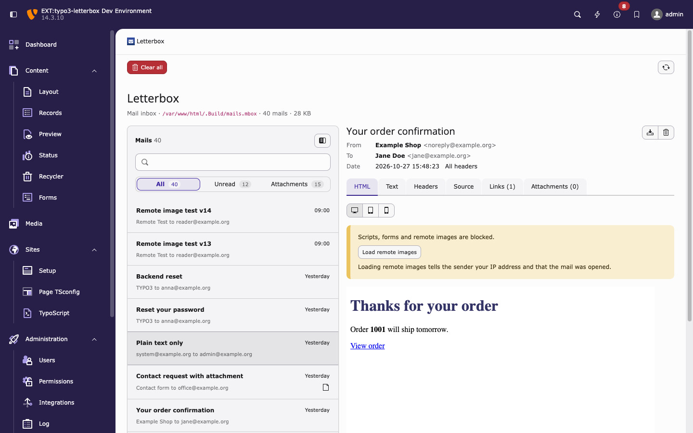
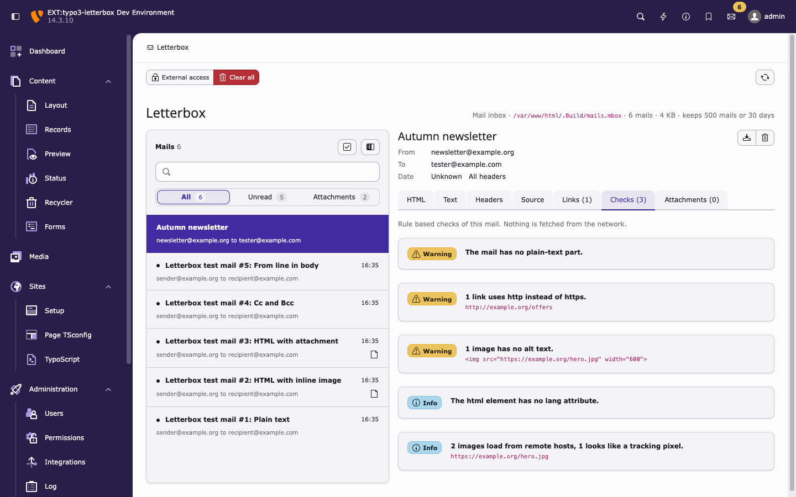

# Backend module

Back to [documentation overview](README.md).

The module is under System › Letterbox, for administrators only. It reads the file set in `transport_mbox_file`, so existing mbox files stay readable.

## Inbox

* The mail list shows caught mails with pagination and scrolls inside its own area. It can be collapsed to give the detail view the full width, stored per backend user.
* Each row shows the subject and "sender to recipient", with names where the mail has them.
* Search finds mails by sender, recipient (name or address) and subject. The quick filters All, Unread and Attachments show counts for the current search. Search, filter and page stay in every link.
* Unread mails carry a dot. A mail counts as read once its detail view was opened, per backend user, for at most the 2000 most recently read mails. With the Unread filter active, an opened mail stays in the list until the list is fetched again. "Mark all as read" in the list header marks every mail as read for this user only.
* The detail view has these tabs:
  * HTML: the sandboxed preview, with a Preview and Code switch. Code shows the HTML part as sent, escaped and unsanitised. It is also shown, without the switch, when no preview can be built (HTML over 2 MiB, too many elements or a parse failure).
  * Text: the plain text part, with `http` and `https` URLs linked
  * Headers: the main headers, with an "All headers" link
  * Source: the raw message, which can be downloaded
  * Links: every link in the mail with copy and open buttons. Password reset links are flagged.
  * Checks: findings sorted error, warning, info. The tab counts errors and warnings. See [Checks](#checks).
  * Attachments: each attachment can be downloaded
* The meta line above the list shows the mbox file, the number and size of the mails and the [retention limits](operations.md#retention).
* Header actions are icon buttons: download `.eml` and delete. Deleting a mail and clearing all mails ask for confirmation first. Opening a mail that no longer exists returns to the list with a message. Messages after delete, clear and mark all read appear as toasts, not above the module.
* Without caught mails the module shows an empty state. When `debugMode` is enabled in the [extension settings](configuration.md#extension-settings), it also shows the command that sends test mails.

## HTML preview

The width can be switched between desktop (full width), tablet (520px) and mobile (360px).

The preview runs in a sandboxed frame from its own route (`system_letterbox.preview`) with a restrictive content security policy. Remote images are blocked. "Load remote images" allows them for the current mail only, over https. Images that point to a missing `cid:` part are reported above the preview.

A PNG, JPEG, GIF or WebP image used more than once is embedded only once, as the background of a placeholder with the same size, so a newsletter that repeats its logo a thousand times keeps the preview small. Other repeated images (SVG, or images whose size PHP cannot read) are embedded on every use until those copies reach 5 MB. References beyond that stay empty and are listed with the missing `cid:` parts.

## Not the mail transport

While Letterbox is not the active mail transport, the module shows "Letterbox is not catching mails" instead of the inbox, and the meta line reads "Mail inbox · not active". The screen names the transport in use, as type or DSN scheme, host and port (never user, password or query), and has a card "Turn on Letterbox" with:

* a button to the core Settings module and the path to the extension configuration, where `enable` switches Letterbox on (see [switch](configuration.md#switch)),
* the current transport, the extension setting (On or Off), and `LETTERBOX_ENABLE`,
* the three `additional.php` lines as an alternative, with a copy button.

When the mbox file of an earlier setup still holds mails, a line below the card says how many and links "Show them". That list is read-only: the doc header offers no "Clear all" while Letterbox is not the transport.

## Checks

The Checks tab runs fixed rules over the stored mail. Nothing is fetched from the network, links and images are only read. Findings show a badge with the severity word, a message and, where there is something to point at, an excerpt of the offending HTML (at most 120 characters, whitespace collapsed). There are no line numbers. The tab label counts errors and warnings, and shows no number at 0. A mail without findings shows "No findings."

| Rule | Severity | Triggers when |
|------|----------|---------------|
| `script_or_form` | Error | The HTML part contains `script`, `form`, `iframe`, `object` or `embed`. One finding per element type, with the first such tag as excerpt. |
| `html_size` | Warning | The HTML part is larger than 102 KB (104448 bytes), which Gmail clips. |
| `missing_text` | Warning | The mail has no plain-text part, or it is blank. |
| `img_alt` | Warning | An `img` has no `alt` attribute. An empty `alt` counts as set. One finding with the count. |
| `http_link` | Warning | A link starts with `http:`. One finding with the count and the first URL. |
| `from_not_site_domain` | Warning | The domain of the From address is neither a host of a TYPO3 site (including language and base variants) nor a subdomain of one. Skipped when no site exists. |
| `missing_lang` | Info | The HTML part has an `html` element without a `lang` attribute. A fragment without `html` is not flagged. |
| `remote_image` | Info | An `img` loads from `http:` or `https:`. The message says when it looks like a tracking pixel: `width` and `height` attributes, or CSS `width` and `height`, both 0 or 1 (with or without `px`). |

An HTML part over the parser limits (see HTML above) still gets `html_size` and the rules that read only the text, links and From address; the rules that read the HTML structure are skipped.

## External access page

See [external access](external-access.md) for what the page controls.

The "External access" button in the doc header opens `system_letterbox.access`, also admin only. It shows:

* Whether external access is on. When it is off, each reason says what to change, for example which value `LETTERBOX_EXTERNAL_ACCESS` needs.
* Whether `LETTERBOX_ACCESS_TOKEN` is configured (at least 32 characters). The token itself is never shown.
* The ready-to-share tester link `<inbox URL>?t=<link secret>`, once the token is configured, with a copy button. The link secret is derived from the token and opens only the read-only inbox, see [external access](external-access.md#tester-inbox). Admins can read every mail anyway, so the page shows it in full.
* The API base URL and a `curl` example with a placeholder token.
* A reminder that changing the token revokes the link for everyone.

## Navigation without reload

The module is a TYPO3 JavaScript module (`Resources/Public/JavaScript/inbox.js`). Mail rows, pagination, quick filters, the width switch and "Load remote images" replace only the list or the detail view, and search does the same after 300 ms of typing or on Enter. The browser history and the backend URL follow, so back and reload work as usual. Typing in the search field replaces the current history entry instead of adding one per keystroke; Enter adds one.

Without JavaScript every one of these is a normal link or form and loads the full page.

Known limitations:

* In Chrome, the first Tab after opening an HTML mail without reload can move focus out of the module frame. Core modules behave the same.
* The backend URL is kept in sync through core's `typo3-iframe-loaded` event. If core stops dispatching it, the address bar stays on the previous URL.

The module is complemented by a [toolbar item, a Reports status and a dashboard widget](operations.md#toolbar-item).

The number of mails per page and the module itself are set in the [extension settings](configuration.md#extension-settings).
