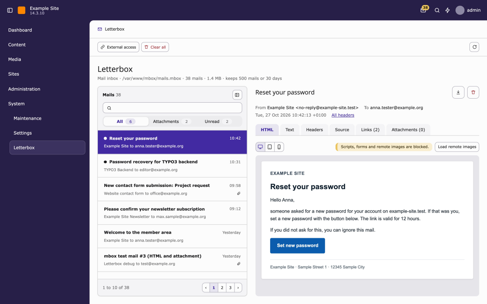
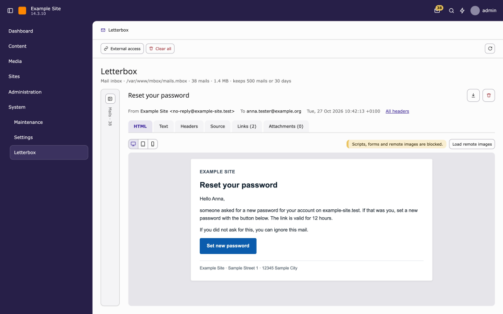
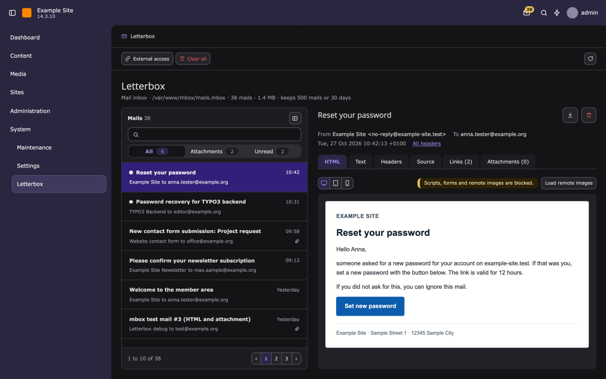
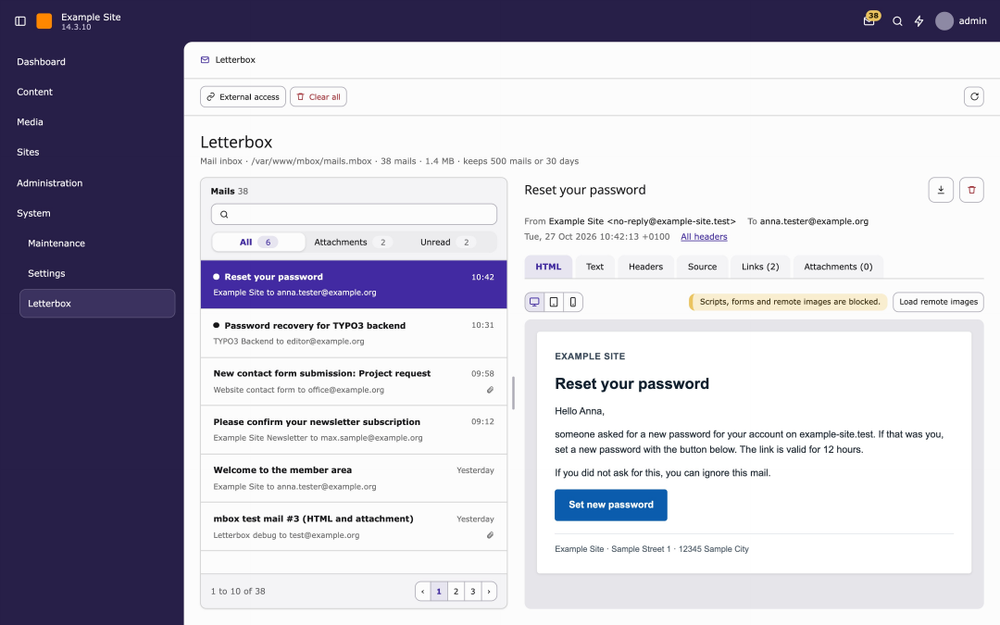
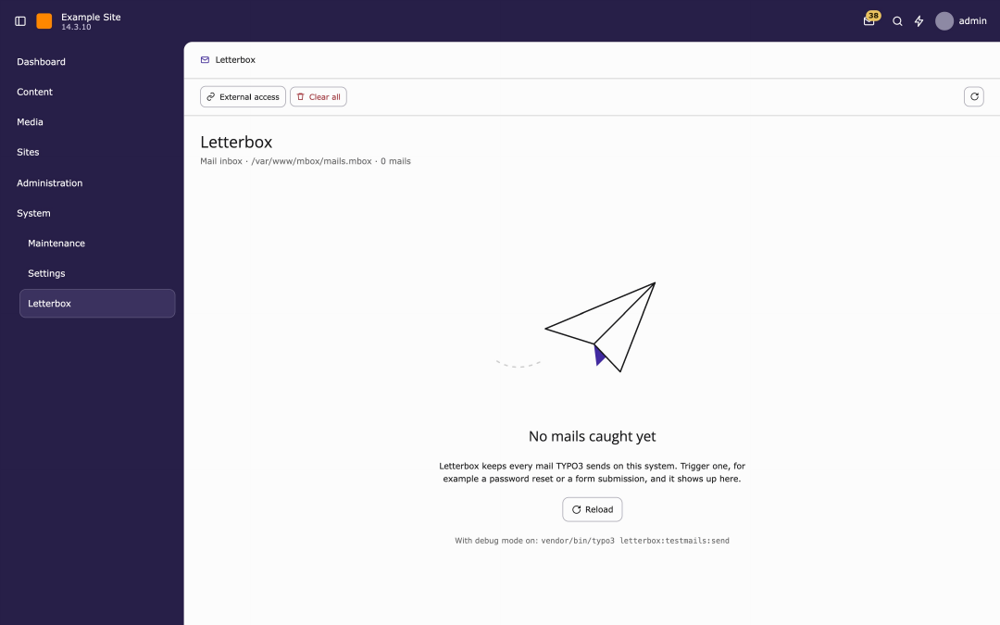
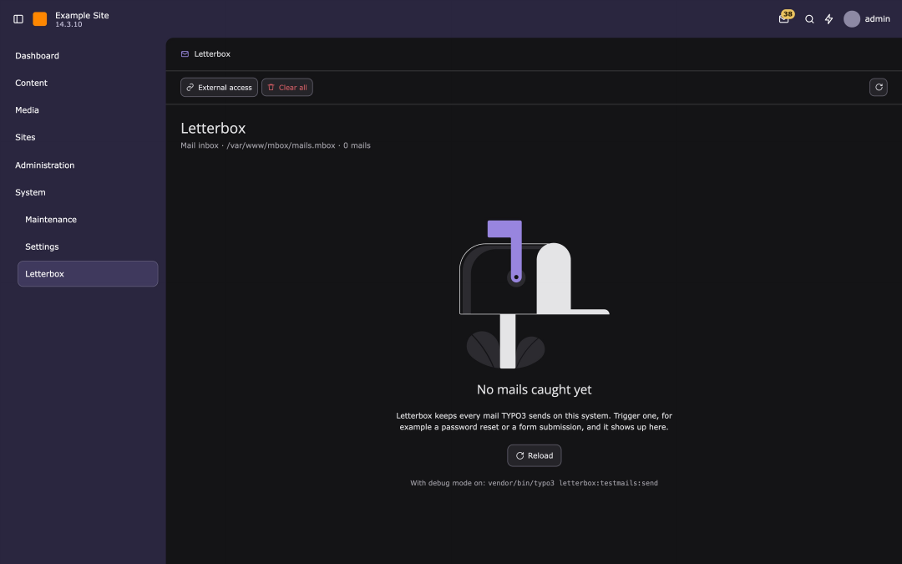
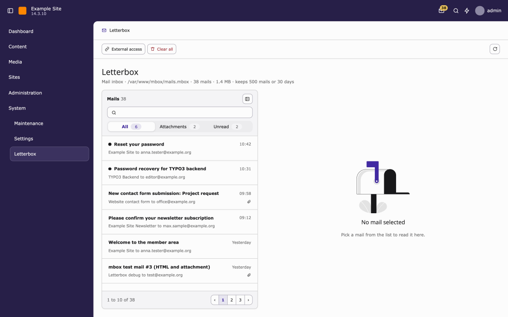
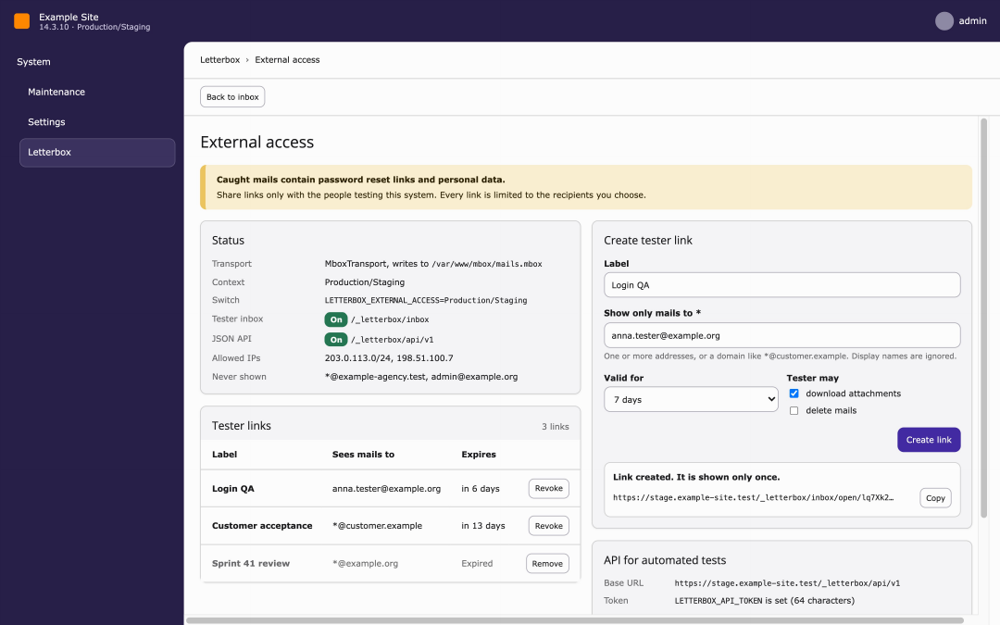
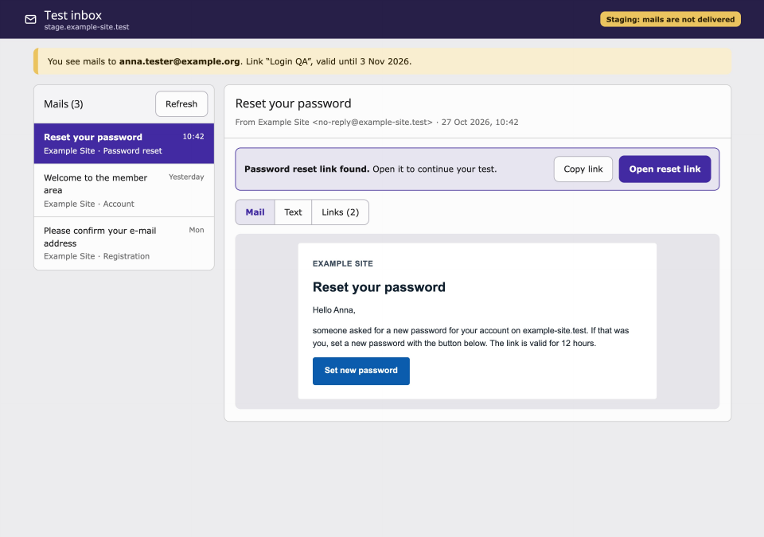
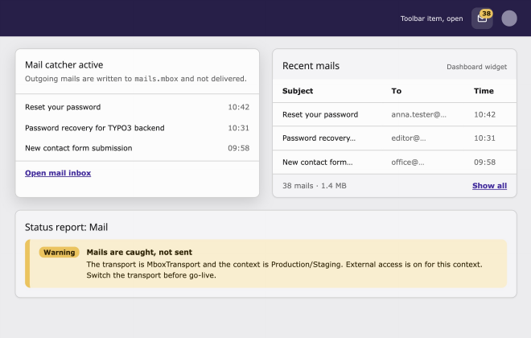

# Screen designs

Back to [documentation overview](../README.md).

The reference designs for every Letterbox screen live on a design canvas: https://claude.ai/artifact/2PrmpeU4WsAhDv2Fn8opeH. The canvas is private to its owner until it is shared from its Share menu.

The canvas draws the TYPO3 shell (top bar, module menu) for context only. The module renders its body and doc header; the shell comes from core. Values in the mockups are examples.

The rules behind these screens are in [rules.md](rules.md). The previews are exports of the canvas; click one for the full size. When a board changes on the canvas, export it again and replace its file in `screens/`.

## Backend module

| Board | Screen | What it settles | Preview |
| --- | --- | --- | --- |
| Inbox (light) | Inbox with list and detail | Heading and meta line, list rows, quick filter, pagination, mail header, icon actions, tabs, preview frame and width toggles, list hide button |  |
| Inbox, list collapsed | Inbox with hidden list | The 52px rail and its show button |  |
| Inbox (dark) | Same as light in dark mode | Core dark values apply without own tokens |  |
| Inbox, resizable list | Alternative to the hide button | Splitter with mouse, keyboard and double-click; under review |  |
| Empty inbox (light) | Inbox without mails | Illustration, heading, sentence, Reload and the debug hint in place of both columns |  |
| Empty inbox (dark) | Same in dark mode | The illustration follows the theme |  |
| No mail selected | Inbox, nothing opened | The 150px illustration, `h2` "No mail selected" and one sentence in the detail column |  |
| External access | Sub page of the module | Status card with token state, card with inbox URL, API URL and example. The screenshot still shows the earlier tester links table and form |  |

The canvas also has a board "Backend module · Not the mail transport", implemented as described in [rules.md](rules.md#states), and a board for the Checks tab. They are not exported to `screens/` yet, the owner exports them later. Screenshots 05 and 06 are outdated, see their rows.

## Outside the backend and system surfaces

| Board | Screen | What it settles | Preview |
| --- | --- | --- | --- |
| Tester inbox | Page for testers without a backend account | Header, list, reset link callout, view switch, 44px targets. The scope note in the screenshot is gone |  |
| Toolbar item, dashboard widget, status | Toolbar dropdown, "Recent mails" widget, reports entry | Wording, admin-only content, warning severity |  |
